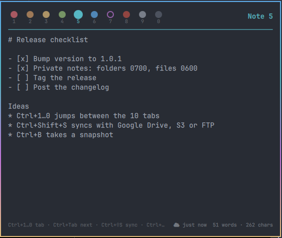

# Tot for Omarchy

Tot-style scratch notes in the [Omarchy](https://omarchy.org) bar: ten colored
tabs, autosaved plain-text files, keyboard driven, with optional cloud sync
(Google Drive, S3, FTP and anything else rclone supports) and backups.



- 10 notes, one color each (taken from your current Omarchy theme)
- Autosave to `~/.local/share/omarchy-tot/note-1.md` … `note-10.md`
- Global shortcuts to open the panel or jump straight to a note
- Two-way cloud sync + daily snapshots with retention and restore
- UI in English, French, Spanish, German and Portuguese

## Dependencies

- Omarchy (Quattro shell) and Hyprland: required.
- `bash`, `jq`, `flock`, `tar`, `notify-send`: already present on Omarchy.
- [rclone](https://rclone.org): optional, only for cloud sync.

## Install

```bash
omarchy plugin add https://github.com/momostifler96/omarchy-tot.git --enable
```

The notes panel works right away. Two optional extras:

```bash
~/.config/omarchy/plugins/momoledev.tot/install.sh             # tot-notes / tot-sync commands
~/.config/omarchy/plugins/momoledev.tot/install.sh --bindings  # + global shortcuts
```

`install.sh` links the `tot-notes` and `tot-sync` scripts into `~/.local/bin`.
Only with `--bindings`, it also appends the shortcuts below to
`~/.config/hypr/bindings.lua`, after saving a timestamped backup
(`bindings.lua.bak.<time>`). Nothing else in your configuration is modified.

## Uninstall

```bash
tot-sync disable 2>/dev/null                 # stop automatic sync, if enabled
rm -f ~/.config/systemd/user/tot-sync{.service,-debounced.service,.timer,.path} \
      ~/.config/systemd/user/tot-backup.{service,timer}
systemctl --user daemon-reload
rm -f ~/.local/bin/tot-notes ~/.local/bin/tot-sync
omarchy plugin remove momoledev.tot
```

If you used `--bindings`, delete the `-- Tot notes` block at the end of
`~/.config/hypr/bindings.lua`. Your notes are kept. Delete them, the backups and
the settings only if you no longer need them:

```bash
rm -rf ~/.local/share/omarchy-tot ~/.local/share/omarchy-tot-backups \
       ~/.local/state/omarchy-tot ~/.config/omarchy-tot
rclone config delete tot-gdrive   # or tot-s3 / tot-ftp, if created by the setup wizard
```

Move the icon elsewhere in the bar with
`omarchy bar move momoledev.tot --section center`.

## Shortcuts

| Global (Hyprland)             | Action                         |
|-------------------------------|--------------------------------|
| `Super+Ctrl+J`                | Toggle the notes panel         |
| `Super+Ctrl+Alt+1` … `0`      | Open note 1 … 10               |

| In the panel                                    | Action                   |
|-------------------------------------------------|--------------------------|
| `Ctrl+1…0` or `Alt+1…0`                         | Go to note 1 … 10        |
| `Ctrl+Tab` / `Ctrl+Shift+Tab`, `Ctrl+PgDn/PgUp`, `Alt+←/→` | Next / previous note |
| `Ctrl+Shift+S`                                  | Sync now (or set up the cloud) |
| `Ctrl+B`                                        | Backup now               |
| `Ctrl+Shift+C`                                  | Copy the whole note      |
| `Ctrl+E`                                        | Open the note in your editor |
| `Esc`                                           | Close                    |

Number keys are matched by physical position, so AZERTY layouts work without Shift.
Left-click the bar icon to toggle the panel, right-click to open the current
note in your editor.

## Cloud sync and backups

Requires [rclone](https://rclone.org) (`mise use -g rclone@latest` or `pacman -S rclone`).

```bash
tot-sync setup            # wizard: Google Drive, S3, FTP/FTPS or any rclone remote
tot-sync status
tot-sync sync             # two-way sync now
tot-sync backup           # snapshot now (local + cloud)
tot-sync backups          # list snapshots
tot-sync restore latest   # restore (current notes are snapshotted first)
tot-sync enable|disable   # automation (systemd user units)
```

Once set up, notes sync 20 s after an edit and every 5 minutes, and a snapshot
is taken daily. Conflicts keep the newest version; the other one is saved next
to it as `note-N.conflictX.md`. Settings live in `~/.config/omarchy-tot/sync.conf`.

Cloud layout: `<remote>/notes` (synced notes) and `<remote>/backups` (snapshots).

## Settings

In `~/.config/omarchy/shell.json`, on the `momoledev.tot` bar entry (or from the
widget settings):

| Key        | Default | Values                                  |
|------------|---------|-----------------------------------------|
| `language` | `en`    | `en`, `fr`, `es`, `de`, `pt`, `auto`    |
| `width`    | `560`   | panel width                             |
| `height`   | `440`   | panel height                            |
| `fontSize` | `14`    | editor font size                        |

`tot-sync` uses the same `language` setting (override with `TOT_LANG=de`).

## Files

| Path                                  | Content                         |
|---------------------------------------|---------------------------------|
| `~/.local/share/omarchy-tot/`         | the notes                       |
| `~/.local/share/omarchy-tot-backups/` | local snapshots                 |
| `~/.local/state/omarchy-tot/`         | current tab, sync status        |
| `~/.config/omarchy-tot/sync.conf`     | cloud settings                  |

These folders are created with mode `0700` and their files with `0600`, so other
users of the machine cannot read your notes. Cloud credentials are stored by
rclone in its own config (`~/.config/rclone/rclone.conf`), never by Tot.

## License

MIT
